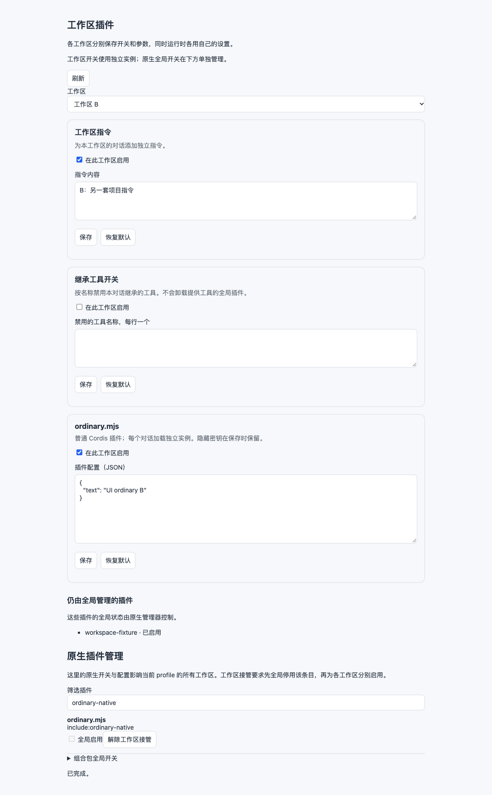

# DSH 工作区插件管理器

开发预览 `0.2.0-alpha.1`，目标宿主为 DSH `0.2.1-rc.2`。提供原生插件管理与工作区插件管理，源码与验证在独立目录中完成。

无需逐个编写适配器，即可发现原生插件、启停可寻址条目/组合包、编辑活动条目的配置。工作区层可以直接加载依赖作用域接口的普通 Cordis Host 插件，让 A/B 对话使用独立的实例和参数。提供全局服务或跨工作区操作的插件继续使用原生全局管理。

对话按自己的工作目录及其所属工作区解析设置；界面切换不会改变其他对话的配置。工作区修改在下一次提示词组装前应用，不撤销已经发出的请求。管理器使用 DSH 原生 Config/Settings 保存配置，不修改宿主文件，不切换已有会话的 Agent 预设。

## 当前已实现

- 工作区选择、逐插件开关、逐字段配置、恢复默认。
- 自动发现原生插件与组合包；复用原生开关，保留只读原因、失败、覆盖和需要重启的结果。
- 通用 JSON 配置编辑，使用插件原生 Config 校验；过期写入拒绝，标记为 secret 的字段脱敏并在省略时保留。
- 普通 Cordis 插件直接接管到工作区，不要求实现 `workspacePlugins.register()`。
- 同时运行的 A/B 对话使用各自配置；同一工作区的多个对话分别持有注册。
- 配置通过当前 profile 中管理器自己的 `workspace-plugin-manager` 条目持久化。
- 原生 `agent/created` / `agent/disposed` 生命周期接入；对已有 Agent 在下一次组装时接入。
- 工作目录变更后，管理器拥有的注册在下一次组装前重新绑定。
- 跨工作区适配接口在调用执行函数前检查来源、目标的开关和对话来源；运行中或有待处理输入时拒绝。
- 原生插件清单中的其他组合包以“仍由全局管理”展示，不提供无效的工作区开关。

随包提供两个实际功能：**工作区指令**和**继承工具开关**。继承工具开关限制全局工具的可见性/可调用性，不会停止其后台进程，也不能隐藏精确 Agent 层自己的工具。

独立验证页面如下，工作区及插件内容均为临时验证数据：



## 兼容范围

两种工作区接入方式：

1. **普通插件直接加载**：在“原生插件管理”中先全局停用对应条目，等待宿主实际卸载，再点击“接管到工作区”。随后为各工作区分别启用并编辑 JSON 配置。解除接管保留已保存偏好，全局条目继续停用，是否恢复由用户通过原生开关决定。
2. **显式适配接口**：用于跨工作区操作，或需要定制挂载/校验的插件。原有接口继续支持。

直接加载当前支持无依赖或只依赖 `systemPrompt`、`tools`、`commands` 的 Cordis Host 模块。全局活动条目、受保护条目、组合树和需要其他全局服务的模块不会直接接管。激活时若发现插件向根 realm 提供服务，会清理本次实例并拒绝该工作区的激活。详情见[通用管理范围](docs/GENERAL_MANAGEMENT.md)。

显式适配接口支持：

| `scope` | 含义 |
| --- | --- |
| `workspace` | 通过 `mount(ctx, config, { agent, workspace })` 注册此 Agent 的贡献 |
| `cross-workspace` | 通过 `execute({ source, target, payload, agent })` 执行同时涉及两个工作区的操作 |
| `global` | 仅展示为全局插件，拒绝保存工作区覆盖 |

工作区插件示例：

```js
export const inject = ['workspacePlugins']
export function apply(ctx) {
  ctx.effect(() => ctx.workspacePlugins.register({
    id: 'my-workspace-prompt', title: '项目指令', scope: 'workspace',
    defaults: { text: '' },
    fields: { text: { type: 'multiline', title: '指令内容' } },
    mount(agentCtx, config) {
      return agentCtx.get('systemPrompt').section({
        name: 'my-plugin:prompt', order: 96, text: config.text,
      })
    },
  }))
}
```

`mount` 只做注册，不驱动 Agent；它返回的清理函数由管理器拥有。两种方式都在同一宿主进程中运行：模块全局变量、外部文件、后台任务及自行调用全局注册表的代码不会自动隔离。作用域检查不构成权限沙箱。原生全局开关影响整个 profile，不能用于模拟某个工作区的独立开关。

## 跨工作区迁移

默认规则为来源与目标均启用才准入。`runCrossWorkspace(pluginId, sourceId, targetId, { sessionId })` 在 Host 端调用已注册的 `execute`，没有向浏览器开放任意执行回调。

**当前没有接管已安装的 dsh-session-workspace。** 它原来的全局 RPC 仍独立存在；在新接口中加检查不会限制旧 RPC，因此本原型不会声称已经控制了它。接入该插件时必须让其所有菜单、拖拽与 RPC 执行路径使用统一准入，并保留原迁移实现对会话释放、待处理输入、磁盘写入及回滚的检查。管理器的状态检查不能代替迁移期间的原子性。

迁移验证中的执行函数是测试适配器，只修改临时 Agent 的工作目录，未迁移真实会话文件。验证通过说明管理器能阻止调用、传入两端独立配置、重新绑定自身贡献；不能据此声称磁盘迁移已经验收。

## 验证

需要 Node.js 24 或更新版本，以及 DSH `0.2.1-rc.2` 的**隔离 SDK 副本**。副本目录须含 `package.json` 和可解析的 `node_modules/@deepseek-ai/`，包括 Cordis、Scope、Tools、Agent、SystemPrompt、App Boot、Settings、ConfigEditor 及它们的依赖。SDK 不随本仓库分发。

使用系统 Node，在仓库根目录执行；`DSH_NATIVE_ROOT` 必须显式指向独立副本，解析 hook 没有运行中应用的默认路径：

```sh
export DSH_NATIVE_ROOT=/absolute/path/to/isolated-sdk
npm run check
npm test
npm run test:native
npm run test:general
```

`test:native` 会在本仓库被 Git 忽略的 `.verification/` 下创建独立 profile，使用原生 Loader、Settings、ConfigEditor 验证表单投影、配置落盘、销毁/重建后的恢复，以及两个工作区的不同提示词。它不启动 DSH 桌面服务，不连接运行实例，不发模型请求。

`test:general` 还需要 SDK 副本包含 `dsh-plugin-manager`、`dsh-host-plugin-inventory` 及依赖。它使用真实原生管理器检查发现、全局配置、脱敏、原生启停结果，以及普通插件直接接管后的 A/B 独立配置和重建恢复。

`test:client` 额外需要显式设置 `WPM_BROWSER_DEPENDENCIES`（已含 Playwright 的目录）、`WPM_REACT_DEPENDENCIES`（已含 React 18 和 React DOM 18 的目录）与 `WPM_CHROME_EXECUTABLE`（独立 Chrome/Chromium 可执行文件）。设置 `WPM_NATIVE_CATALOG=1` 可验证完整原生管理与直接接管页面。该脚本不下载依赖或浏览器，全部页面请求由测试路由拦截。输出与截图也写入 `.verification/`。

核心检查共 28 项，当前在系统 Node 26.12.0 通过；旧版 17 项核心检查另有 Node 24.21.0 记录。临时原生 profile 与独立浏览器验证记录见 [验证说明](docs/VALIDATION.md)。正式桌面安装、在线模型循环和真实迁移尚未验收；此预览不提供正式安装脚本。`package.json` 中的 `private: true` 用于避免意外发布到 npm，不影响本仓库公开。

## 来源

见 [THIRD_PARTY_NOTICES.md](THIRD_PARTY_NOTICES.md)。保留了上游 MIT 许可证，并区分直接改编代码与仅参考的设计。另附[源码审查](docs/SOURCE_REVIEW.md)和[上游提交及归档校验记录](docs/upstream-provenance.json)。
